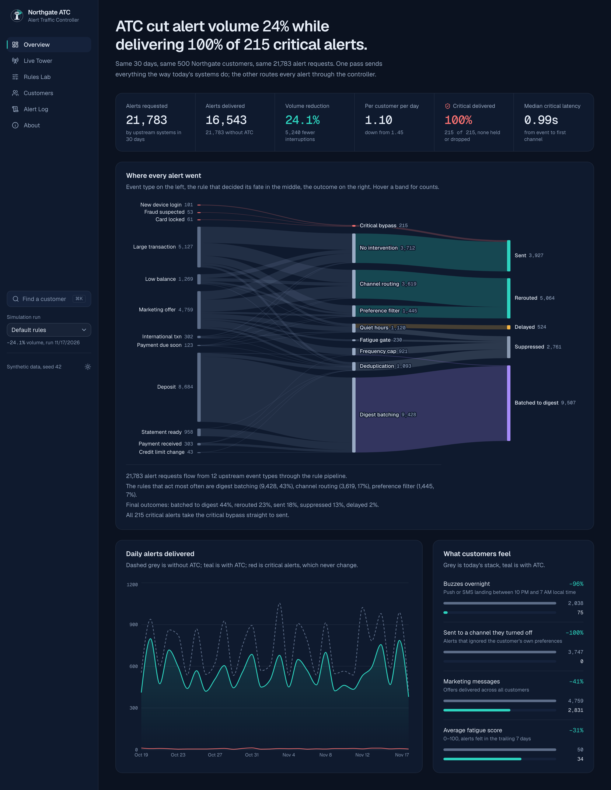
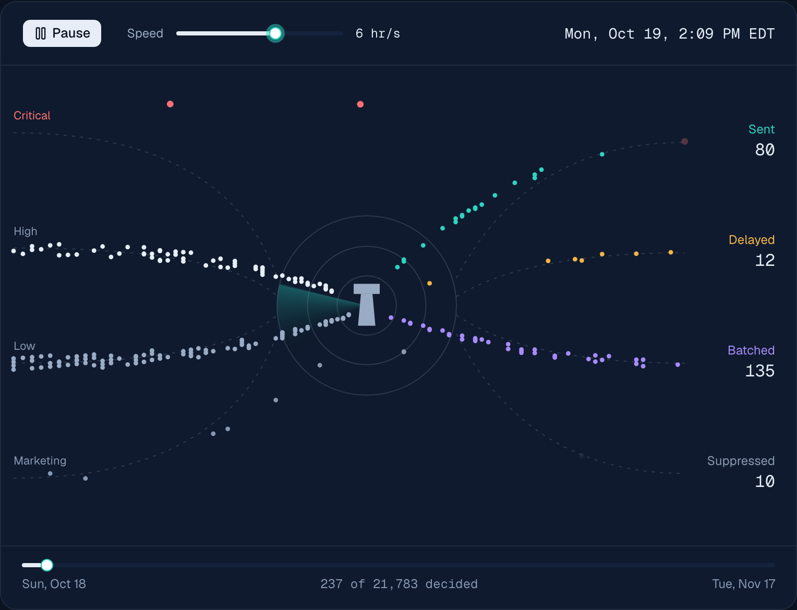
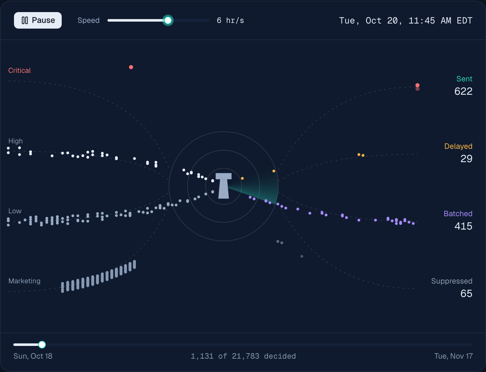
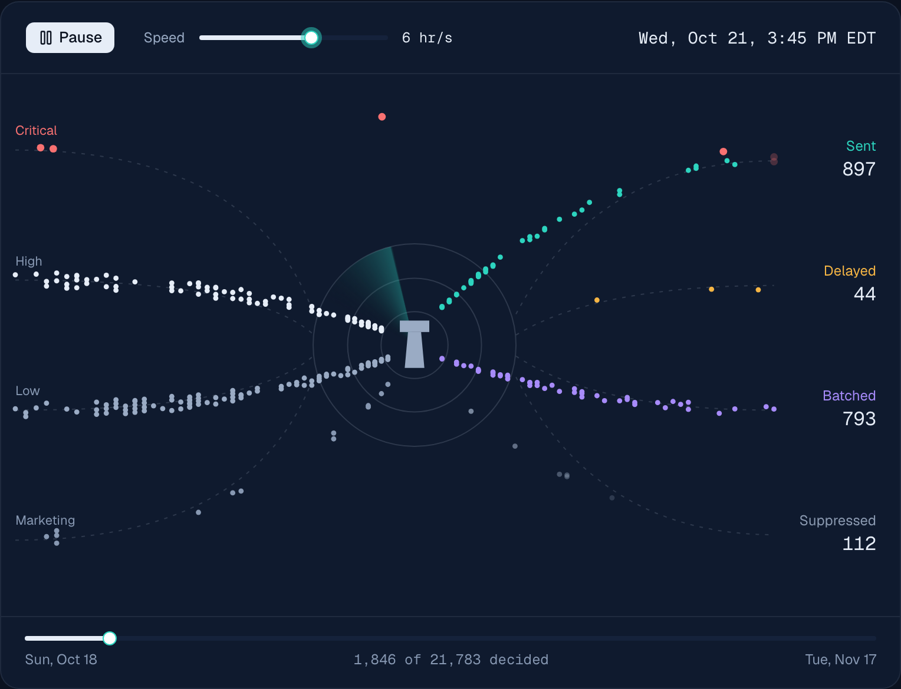
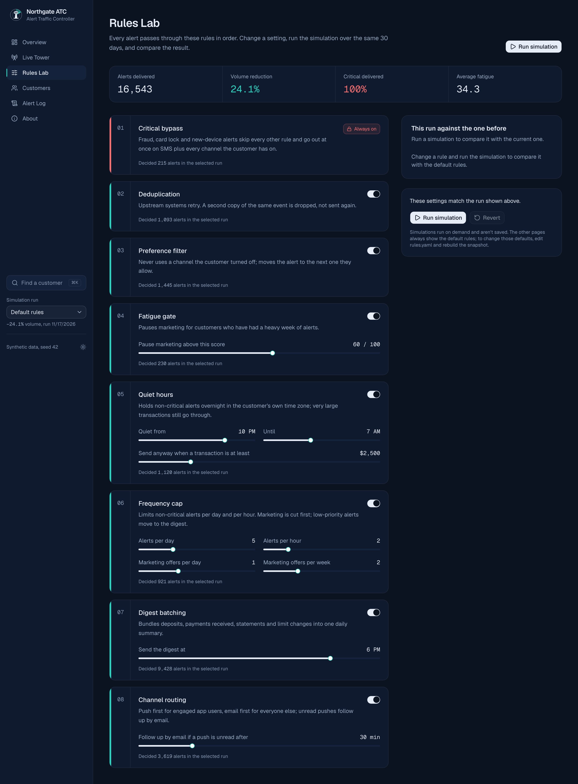
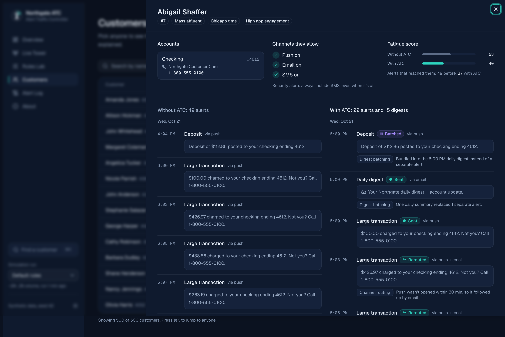
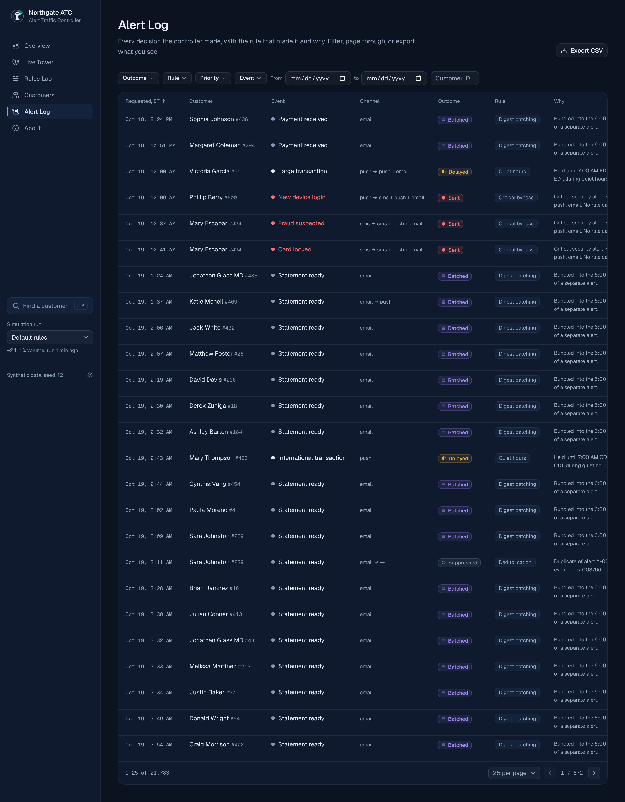
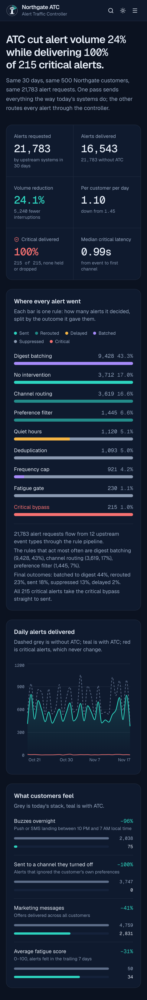
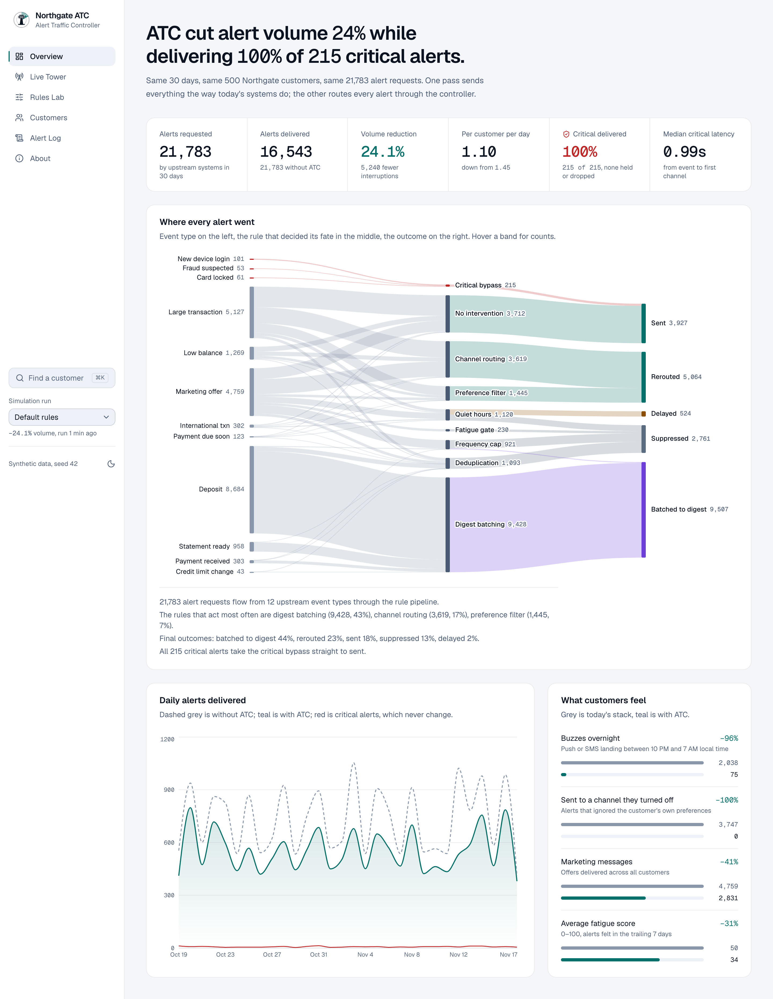
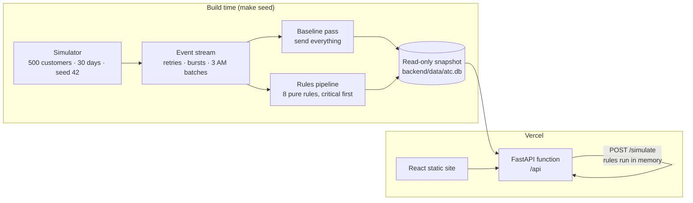

# Alert Traffic Controller

**One gateway between a bank's alert systems and its customers: fewer, better-timed alerts, and zero critical alerts ever held back.**



Northgate Bank is fictional and every customer, account and alert here is synthetic (seed 42).

## The problem

At a typical retail bank, balance, transaction, fraud, payment, statement and marketing alerts are each fired by a different system. None of them knows what the others just sent. The customer gets the sum: a statement email at 3 AM, a deposit push, a retried duplicate, two offers before breakfast.

The real cost isn't the volume. Customers who are buried in alerts turn them off, and then the one that matters ("Did you just spend $900 in another country?") never reaches them.

## Inspiration

In 2018 LinkedIn Engineering described how they fixed the same problem for notifications in [**Air Traffic Controller: Member-First Notifications at LinkedIn**](https://engineering.linkedin.com/blog/2018/03/air-traffic-controller--member-first-notifications-at-linkedin): route every message through one gateway that decides what to send, when and on which channel, based on each member's history and preferences.

ATC applies that idea to retail banking, where one class of message carries a rule LinkedIn didn't have: **security alerts can never be suppressed or delayed.** It draws on my time as a Professional Services Engineer supporting customer alerts on a core banking platform, including routing each customer to the right service line for bank-branded versus cobrand card accounts.

## Key results

Default rules, same 30 days, same 500 customers, same 21,783 alert requests. Baseline = today's stack, where every request is sent exactly as the upstream system asked.

| Measure | Baseline | ATC | Change |
|---|---:|---:|---:|
| Alerts delivered | 21,783 | 16,543 | **−24.1%** |
| Alerts per customer per day | 1.45 | 1.10 | −24% |
| Push/SMS between 10 PM and 7 AM local time | 2,038 | 75 | **−96%** |
| Sent on a channel the customer turned off | 3,747 | 0 | **−100%** |
| Marketing messages | 4,759 | 2,831 | −41% |
| Average fatigue score (0–100) | 49.5 | 34.3 | −31% |
| **Critical alerts delivered** | 215 / 215 | **215 / 215** | **100%, none held** |
| Median critical latency | n/a | 0.99 s | |

Along the way ATC suppressed 1,093 upstream retries, bundled 9,507 routine alerts into 7,028 daily digests, and paused marketing for 135 fatigued customers.

**A note on the 24%.** The simulator uses deliberately conservative, realistic volumes (about 0.6 routine alerts per customer per day), so most daily digests replace only one or two alerts. The bigger wins are in the alerts customers *feel*: overnight buzzes, ignored preferences and marketing overload. Turn the rules up in the Rules Lab and you can trade volume for timeliness and watch the effect, while the critical row never moves.

## Live Tower

A canvas replay of all 30 days. Each dot is one alert request entering the controller and leaving with its outcome. Critical alerts (red) take an express lane over the tower.

| | | |
|---|---|---|
|  |  |  |

## The dashboard

| Rules Lab | Customer Explorer | Alert Log |
|---|---|---|
|  |  |  |

- **Overview:** headline KPIs, a Sankey of event type → deciding rule → outcome, and daily volume before and after.
- **Live Tower:** the replay above, with play, pause, speed and scrub controls and a ticker of decisions.
- **Rules Lab:** toggle and tune every rule, rerun the full 30-day simulation in memory (~0.5 s), and compare against the previous run.
- **Customers:** search with ⌘K. Each customer gets a side-by-side timeline of what they'd get today versus with ATC, every decision explained in plain English, and the correct service phone number for each account, including cobrand partner lines.
- **Alert Log:** every decision, filterable, with CSV export.

Dark by default with a light mode, responsive down to 390 px, and WCAG 2.1 AA (axe-audited on every page in both themes).

<p>
  
  
</p>

## Architecture



The deployed app never writes to disk. The dataset, baseline and default run are computed once at build time and committed as a read-only SQLite snapshot (a test fails if it drifts from the code). `POST /simulate` runs the same pure engine in memory against that snapshot and returns the summary, Sankey and daily series directly; nothing is saved.

**Rule pipeline (in order):** critical bypass → deduplication → preference filter → fatigue gate → quiet hours → frequency cap → digest batching → channel routing. Every rule is a pure class behind one `Rule` protocol, configured from [`rules.yaml`](rules.yaml) and editable from the dashboard.

| Tier | Events | Treatment |
|---|---|---|
| Critical | fraud suspected, card locked, new-device login | Bypasses everything. Sent instantly on SMS plus every enabled channel |
| High | low balance, large / international transaction, payment due | Dedup, quiet hours (unless above $2,500), routing |
| Low | deposit, payment received, statement, credit-limit change | All rules; batched into a 6 PM daily digest |
| Marketing | offers | All rules; strictest cap, cut first, never during quiet hours |

### How the critical guarantee is enforced

1. The critical bypass always runs first and ends evaluation.
2. Config validation rejects any pipeline that moves or removes it, and bounds critical latency.
3. `AlertRequest` refuses a priority that doesn't match its event type, so a fraud alert can't be mislabeled into a lower tier.
4. A runtime guard raises if a critical decision is ever not sent instantly on SMS plus every enabled channel.
5. Hypothesis property tests generate random event streams *and* random rule configurations (reordered, toggled, extreme caps) and assert that critical requested == critical sent, none delayed.

## Design decisions and tradeoffs

- **SQLite, not a server database.** One file, zero setup, `make setup && make dev` on a fresh clone. The workload is read-heavy analytics over ~45k rows. Postgres would add operations work and buy nothing here.
- **Read-only deployment.** Serverless functions have no durable disk, so instead of adding a database service, everything stored is precomputed into an immutable snapshot and every what-if is computed on request. The trade-off: simulations live only in the browser session (the Rules Lab keeps them for comparison) rather than becoming shareable runs.
- **A heuristic fatigue score, not ML.** `score = 100 × weighted alerts in the last 7 days ÷ 18`, with critical weighted 0 and overnight deliveries ×1.5. It's explainable to a customer, an auditor or a product review, needs no training data, and is easy to tune from the dashboard. A model predicting opt-outs is the natural next step, behind the same rule interface.
- **Rule order is a product decision.** Dedup runs before caps so retries don't eat a customer's budget. The fatigue gate runs before the frequency cap so a tired customer's marketing never spends cap headroom (moved up from the original spec order for this reason). Quiet hours run before caps so held alerts count on the morning they land. Routing runs last, once an alert is definitely going out.
- **Critical retries are sent, not deduplicated.** Dedup could hide a genuine second fraud event, so ATC accepts the occasional duplicate fraud SMS. Safety beats tidiness.
- **SMS overrides the customer's SMS opt-out for security alerts only.** That matches how banks treat fraud alerts; marketing and routine alerts always respect the opt-out.
- **Pure engine, impure shell.** The engine has no clock, I/O or randomness (push opens are a deterministic hash of the alert ID), so runs are reproducible and the property tests are meaningful.

## Run it in under 2 minutes

Prerequisites: [uv](https://docs.astral.sh/uv/) and Node 22+.

```bash
git clone https://github.com/evanz0820/alert-traffic-controller.git
cd alert-traffic-controller
make setup   # installs backend + frontend deps and rebuilds the snapshot (~2 s)
make dev     # API on :8000 (docs at /api/docs), dashboard on http://localhost:5173
```

Or, optionally, with Docker: `docker compose up --build`.

| Command | What it does |
|---|---|
| `make test` | Backend tests with coverage (engine must stay ≥ 90%) and frontend type check |
| `make lint` | ruff, ruff format, mypy (strict on the engine), ESLint, Prettier, tsc |
| `make seed` | Rebuild the read-only snapshot `backend/data/atc.db` (commit it afterwards) |
| `make screenshots` | Every page at 1440 px and 390 px, dark and light; fails on console errors or horizontal overflow |
| `make qa` | axe WCAG 2.1 AA audit of every page plus interaction checks |
| `vercel deploy --prod` | Deploy (see below) |

## Deploy to Vercel

The repo deploys as one Vercel project: the React app as static files from `frontend/dist`, and FastAPI as a Python function (`api/index.py`) for everything under `/api`. [`vercel.json`](vercel.json) holds the build settings, function bundle and rewrites; `requirements.txt` lists the function's runtime dependencies; `.python-version` pins Python 3.12.

**Option A, from the dashboard (recommended):**

1. Push the repo to GitHub (the snapshot `backend/data/atc.db` must be committed).
2. In Vercel, choose **Add New → Project** and import the repository.
3. Leave **Root Directory** as the repo root and **Framework Preset** as *Other*. Build, install and output settings come from `vercel.json`, so don't override them.
4. Click **Deploy**. Every later push to `main` redeploys automatically.

**Option B, from the CLI:**

```bash
npm i -g vercel        # or use: npx vercel
vercel login
vercel link            # create or link the project; accept the repo root as the directory
vercel deploy --prod
```

**Check the deployment:** open `/` (dashboard), `/api/health` (`{"status":"ok"}`), `/api/docs` (OpenAPI), and run a simulation in the Rules Lab.

After changing the engine, the simulator or `rules.yaml`, run `make seed`, commit `backend/data/atc.db`, and push; the snapshot test in CI catches a stale file.

## Testing

- **247 backend tests**: unit tests for every rule, the simulator, the phone directory and the alert copy; API integration tests against a freshly built read-only snapshot; a check that the committed snapshot matches the code; and Hypothesis property tests.
- **Coverage:** 100% on the rules engine package (`atc.engine`), 99% overall. CI fails if the engine drops below 90%.
- **Property tests:** critical requested == sent and never delayed, for any stream and any valid config. Dedup is idempotent, and retries never change the original alert's fate. Non-critical alerts and digests never use a disabled channel.
- **Time zones:** quiet hours across 7 US zones, the Nov 1 fall-back night (25 hours long), the ambiguous 1 AM hour, spring-forward, and Phoenix (no DST).
- **Cobrand mapping:** every account type and partner resolves to its own line; a cobrand alert never shows the bank's number.
- **Frontend:** strict TypeScript, ESLint, Playwright screenshot checks, and an axe audit of every page.

CI (GitHub Actions) runs backend lint, types and tests plus frontend lint, type check and build on every push.

## Future work

- **Opt-out prediction:** replace the heuristic fatigue score with a model trained on unsubscribes, keeping rule-based guardrails.
- **Real delivery providers:** push, email and SMS adapters with delivery receipts, so routing fallback uses real open signals.
- **Kafka streaming:** run the same pure rules as a stream processor with per-customer state in a key-value store.
- **A/B holdout testing:** keep a random slice of customers on the old stack to measure opt-out and call-center impact causally.
- **Per-segment caps:** different caps and quiet hours for seniors, small business and premium segments.

## Stack

Python 3.12 · FastAPI · Pydantic v2 · SQLModel/SQLite · pytest + Hypothesis · ruff · mypy — React 18 · TypeScript · Vite · Tailwind CSS v4 · shadcn/ui · Recharts · Motion · TanStack Query & Table · Playwright + axe

---

*All data is synthetic. Northgate Bank is fictional; cobrand partner names are illustrative and every phone number uses the fictional 555-01xx range. No real alerts are sent. The API has no authentication, but it is read-only: it serves a precomputed snapshot and computes simulations without storing anything.*
