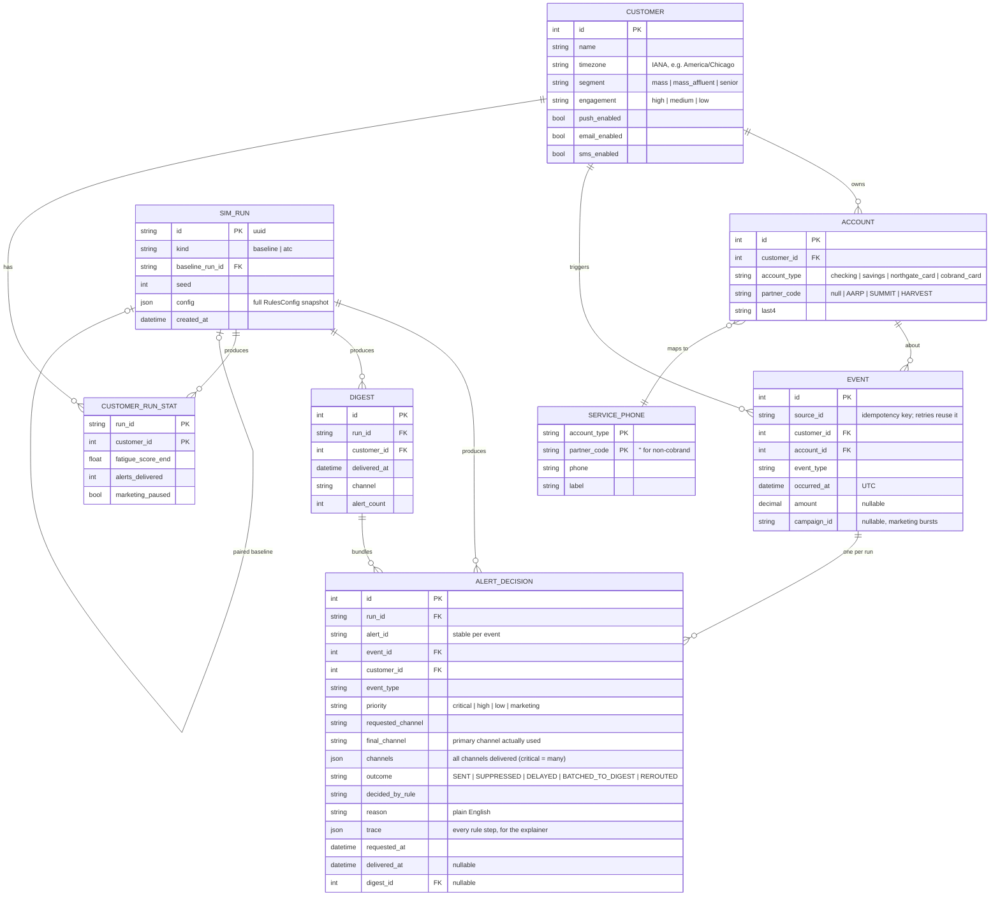

# ATC — Build Plan (awaiting approval)

## 1. Folder structure

```
atc/                                  (repo: alert-traffic-controller)
├── CLAUDE.md  README.md  Makefile  docker-compose.yml  rules.yaml
├── .claude/settings.json             PostToolUse hooks → ruff format / prettier
├── .claude/hooks/format.sh
├── .github/workflows/ci.yml          backend tests+cov, ruff, mypy, tsc, eslint
├── docs/PLAN.md  docs/screenshots/
├── backend/
│   ├── pyproject.toml  uv.lock  Dockerfile
│   ├── src/atc/
│   │   ├── config.py                 RulesConfig (Pydantic) ⇄ rules.yaml
│   │   ├── domain.py                 enums: EventType, Priority, Channel, Outcome, Segment…
│   │   ├── directory/phones.py       account type/partner → service phone
│   │   ├── simulator/
│   │   │   ├── customers.py  accounts.py  events.py   (seeded generators)
│   │   │   └── messiness.py          retries (~5% dupes), bursts, night events
│   │   ├── engine/                   ← mypy strict, ≥90% coverage, pure
│   │   │   ├── types.py              AlertRequest, Decision, CustomerContext, Ledger
│   │   │   ├── pipeline.py           build_pipeline(config) + run(requests) → decisions
│   │   │   ├── baseline.py           "no controller" pass-through
│   │   │   ├── fatigue.py            explainable score
│   │   │   └── rules/  critical_bypass.py dedup.py preference.py quiet_hours.py
│   │   │               frequency_cap.py digest.py routing.py fatigue_gate.py
│   │   ├── db/  models.py session.py repo.py
│   │   ├── analytics/ summary.py flows.py timeseries.py timeline.py replay.py
│   │   └── api/ main.py schemas.py routers/{simulate,runs,customers,config}.py
│   └── tests/ unit/{engine,simulator,directory}/  property/  integration/
└── frontend/
    ├── package.json vite.config.ts tsconfig.json components.json Dockerfile
    └── src/
        ├── app/ App.tsx router.tsx providers.tsx Shell.tsx
        ├── styles/tokens.css          design tokens (dark default + light)
        ├── components/ ui/ (shadcn)  brand/Logo.tsx  charts/ (Sankey, VolumeChart, KpiCard)
        ├── features/ overview/ tower/ rules-lab/ customers/ alert-log/ about/
        └── lib/ api.ts queries.ts format.ts
```

## 2. Data model

Events are generated **once per seed** and reused by every run. Runs differ only in
config, so comparing runs is apples to apples. The baseline run (no controller) is
computed once per dataset and paired with every ATC run.



**Outcome precedence** (one outcome per alert): SUPPRESSED > BATCHED_TO_DIGEST >
DELAYED > REROUTED > SENT. The `trace` keeps every step, so an alert that was rerouted
*and* delayed still explains both.

**Metric definitions**
- *Requested*: alert requests, duplicates included. In the baseline, delivered = requested.
- *Delivered (ATC)*: SENT + REROUTED + DELAYED alerts + digest messages (each digest
  counts as 1).
- *% reduction* = 1 − delivered_ATC / delivered_baseline.
- *Critical delivery rate* = critical delivered / critical requested (must be 100%).
- *Critical latency*: the simulated dispatch latency per channel (deterministic,
  roughly 0.5–3 s). Reported as a median.
- *Fatigue score* (0–100): weighted alerts delivered in the trailing 7 days
  (high = 1.0, low = 0.6, marketing = 1.5, critical = 0, so security never makes you
  "fatigued"), plus a night-delivery penalty, scaled to 100. Paused above 60.

## 3. Rule pipeline

Shared interface (`atc.engine.types`):

```python
class Rule(Protocol):
    name: ClassVar[str]
    def applies_to(self, req: AlertRequest) -> bool: ...
    def apply(self, req: AlertRequest, d: Decision, ctx: CustomerContext) -> Decision: ...
```

`Decision` is immutable (frozen dataclass): outcome, channel, scheduled_at,
terminal flag, trace. A rule either annotates the decision (reroute, delay) or makes it
terminal (suppress, batch); terminal decisions stop the pipeline. The engine walks
requests in time order with a per-customer ledger (delivered history, seen source ids,
pending digest). The ledger is passed in and returned, never global, so the engine stays
pure and fully testable. Rule order and enablement come from `rules.yaml`.

| # | Rule | Applies to | Effect |
|---|---|---|---|
| 1 | Critical bypass | critical | Terminal SENT on **every enabled channel, plus SMS always**; skips all rules |
| 2 | Dedup | all non-critical | Same `source_id` already seen → SUPPRESSED "duplicate of alert X" |
| 3 | Preference filter | non-critical | Requested channel disabled → REROUTED to next allowed (push→email→sms) |
| 4 | Fatigue gate *(moved up, see Q3)* | marketing | Score > threshold → SUPPRESSED "marketing paused (fatigue 72/100)" |
| 5 | Quiet hours | high, low, marketing | 22:00–07:00 local → DELAYED to 07:00 local (DST-safe). High above $ threshold (default $2,500) is exempt. Marketing during quiet hours → SUPPRESSED |
| 6 | Frequency cap | low, marketing (high counts toward budget but is never capped) | Daily cap 5 and hourly cap 2. Marketing has its own cap (1/day) and is dropped first; low over cap → digest |
| 7 | Digest batching | low (configurable list) | BATCHED_TO_DIGEST, one digest per customer per day at 18:00 local |
| 8 | Channel routing | survivors | High engagement → push first; low → email first; always respects preferences. Push not opened within 30 min (seeded open probability by engagement) → email fallback, recorded as REROUTED |

Dedup keys on `source_id` across the whole run, so running it twice is a no-op
(idempotency test).

## 4. API contract (FastAPI, OpenAPI at `/docs`)

| Method | Path | Body / query | Returns |
|---|---|---|---|
| POST | `/simulate` | `{ overrides?: Partial<RulesConfig>, label?: str }` | `{ run_id, baseline_run_id, duration_ms }` |
| GET | `/runs` | `?limit=` | list of `{ id, kind, label, created_at, headline }` (for Rules Lab comparison) |
| GET | `/runs/{id}/summary` | – | `{ requested, delivered:{baseline,atc}, reduction_pct, per_customer_day:{baseline,atc}, critical:{requested,delivered,rate,median_latency_s}, outcomes:{…counts}, by_rule:{…}, avg_fatigue:{baseline,atc}, insight }` |
| GET | `/runs/{id}/flows` | – | `{ nodes:[{name,kind}], links:[{source,target,value}] }`: event type → deciding rule → outcome |
| GET | `/runs/{id}/timeseries` | `?granularity=day` | `[{ date, baseline, atc, critical }]` |
| GET | `/runs/{id}/alerts` | `?outcome&rule&priority&event_type&customer_id&date_from&date_to&page&page_size&sort` | `{ items:[AlertDecision], total, page, page_size }` |
| GET | `/runs/{id}/alerts.csv` | same filters | CSV stream (export) |
| GET | `/runs/{id}/replay` | – | compact columnar arrays `{ t[], type[], priority[], outcome[], rule[] }` for Live Tower |
| GET | `/customers` | `?q&limit` | `[{ id, name, segment, timezone }]` (command palette) |
| GET | `/customers/{id}` | `?run=` | profile + accounts (with service phone) + prefs + fatigue |
| GET | `/customers/{id}/timeline` | `?run=` | `{ baseline:[…], atc:[{…decision, explanation, service_phone}] }` |
| GET | `/config` | – | current `RulesConfig` |
| PUT | `/config` | full `RulesConfig` | validated, written to `rules.yaml`, returns it |
| GET | `/health` | – | `{ status }` |

`POST /simulate` runs synchronously: about 20k events, which should take a few seconds.

## 5. Simulator defaults
- 500 customers, seed 42, US timezones (ET/CT/MT/PT/AK/HI, weighted by population),
  segments mass 60% / mass_affluent 25% / senior 15%, engagement skewed by segment.
- Channel opt-outs: ~15% push off, ~10% email off, ~35% SMS off.
- Accounts 1–3: checking (all), savings, Northgate card, cobrand card. Partners: **AARP**
  (as you asked) plus two invented ones, *Summit Air Miles* and *Harvest Market
  Rewards*. All phone numbers are fictional `1-800-555-01xx`.
  *Note:* your spec says "Barclays credit card". Since the bank is the fictional
  Northgate, I'll call it the **Northgate card**. The mapping logic is the same as your
  Barclays vs cobrand work.
- 30 days of events, Poisson-ish per type per customer: deposits and transactions common;
  fraud, card lock and new device rare; marketing in 3–4 campaign bursts. About 5% retry
  duplicates (same source_id, +5 s to 3 min), bursts of 3–8 events within minutes, and
  real overnight activity.

## 6. Dashboard: design tokens and wireframes

Tokens: bg `#0B1220`, surfaces at 3 elevations (`#111A2E`, `#16213A`, `#1C2945`),
1px borders at `white/8%`, radius 14px. Status colors: sent = teal `#2DD4BF`, delayed =
amber `#F5B544`, batched = violet `#A78BFA`, suppressed = slate `#64748B`, critical =
red `#F87171` (critical only). Geist Sans for UI and Geist Mono with tabular-nums for
metrics. Light mode mirrors this with a near-white bg and darker status colors to keep
AA contrast. Logo: an original radar sweep inside a hexagonal tower glyph, in SVG.

**Shell**: on desktop, a left rail (logo, "Northgate Bank · ATC", 6 nav items with
icons, theme toggle, run picker). On mobile, a top bar with a hamburger that opens a
sheet. Cmd+K opens the command palette everywhere. Pages fade and slide in (Framer).

1. **Overview**: An insight sentence across the top ("ATC cut alert volume 46% while
   delivering 100% of 312 critical alerts."). Then 6 KPI cards in a row (3×2 on tablet,
   1 column on mobile): each shows the ATC value large in mono, the baseline value small
   and struck through, and a delta chip. The critical card has a red shield icon, "100%"
   and a "never suppressed" caption. Below that, a full-width Sankey card (event types →
   deciding rule → outcome) with a hover tooltip showing count and % of source. Under the
   Sankey, a text summary of the top 3 flows (accessibility). Then a daily volume chart:
   baseline (dashed slate) vs ATC (teal area) over 30 days, with a critical line in red.
   On mobile the Sankey collapses to a vertical stacked-bar view of the same data.
2. **Live Tower**: A canvas stage. Lanes from 4 directions (event types) feed a central
   tower glyph, and dots exit right into 4 lanes: Sent, Delayed, Batched, Suppressed,
   each with a live counter. Critical dots are red and take an express lane. Controls:
   play/pause, speed slider (1× to 2000×), day scrubber showing the date and time. On the
   right (below on mobile), a ticker of the latest 12 decisions: time, event type, outcome
   badge, rule badge. Uses requestAnimationFrame with a pooled particle array. Respects
   prefers-reduced-motion by showing counters only.
3. **Rules Lab**: A grid of 8 rule cards, each with an icon, name, one-line description,
   on/off switch (the critical bypass card is locked on with a lock icon and tooltip),
   and sliders for its settings. A sticky footer bar has "Run simulation" and "Reset to
   defaults". After a run, the KPI strip animates from the old to the new values. A
   comparison panel shows the previous run vs the current run side by side (requested,
   delivered, reduction, critical rate, avg fatigue), with deltas.
4. **Customer Explorer**: A searchable, filterable list (segment, engagement, fatigue
   band) plus Cmd+K. Clicking opens a right sheet (full screen on mobile). The sheet has
   a header (name, segment, timezone, local time), account chips each showing their
   service phone, preference toggles (read-only), and a fatigue gauge comparing baseline
   and ATC. Two timeline columns, "Without ATC" and "With ATC" (tabs on mobile). Each
   alert row shows a time, an icon, a preview message including the correct service
   phone, an outcome badge, and an explanation ("Held until 7:00 AM CT: arrived at 11:42
   PM during quiet hours").
5. **Alert Log**: A filter bar (outcome, rule, priority, event type, date range,
   customer), then a TanStack table with server-side pagination and sorting. Columns:
   time, customer, event, priority, requested→final channel, outcome, rule, reason.
   Includes an "Export CSV" button. On mobile, rows become cards.
6. **About**: The problem, the LinkedIn inspiration with a link, the architecture
   diagram (rendered SVG), the rule order and why it matters, the critical guarantee,
   and what I'd build next.

## 7. Stages (commit after each)
1. Scaffold, CLAUDE.md, Makefile, hooks, CI, then git init
2. Domain models and simulator, with tests
3. Rules engine, with unit and property-based tests
4. API, with integration tests
5. Dashboard shell (layout, nav, theme, logo, tokens)
6. Overview page and Sankey
7. Rules Lab and Customer Explorer
8. Live Tower and Alert Log
9. Playwright visual QA at 1440 and 390, fixing issues
10. `/code-review` and pr-review-toolkit pass, fixing important findings
11. README, screenshots, and GitHub push (I'll ask before pushing)

## 8. Environment notes
- This machine is missing `uv` and Node. Stage 1 installs them with Homebrew (`brew
  install uv node`). uv will fetch Python 3.12.
- Docker isn't installed. I'll write `docker-compose.yml` but can't verify it locally;
  CI won't depend on it.
- The folder isn't a git repo yet. Stage 1 runs `git init`.
- Library versions: React 18 (as specified), Tailwind v4 with the Vite plugin, and
  shadcn/ui latest. I'll confirm every API through Context7 before using it.
